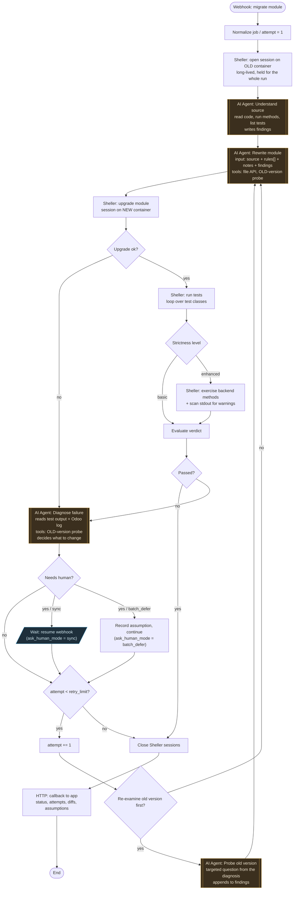

# n8n workflow "migrate-one-module" — flow

One run = one module. The app triggers it, owns all state between runs, and
receives the verdict on a callback. Nothing here accumulates state across
runs.

Two kinds of node, deliberately separated (see the design spec, "Canvas
legibility"): **agent nodes** make judgment calls, **deterministic nodes**
run fixed control flow. Anything an agent does not need to decide is not an
agent's job — it is cheaper, more debuggable and more legible as a node.



Amber = agent node. Blue = pause. Everything else is deterministic.

## Node by node

| Node | Kind | What it does |
|---|---|---|
| Webhook | trigger | Receives the job payload (see the webhook contract in the design spec). |
| Normalize job | deterministic | Unpacks the payload, sets `attempt = 1`, builds the Sheller base URL and container names. Initializes an empty `findings` list. |
| Open OLD session | deterministic | One session on the old container, opened once and held for the whole run. See "The old version stays reachable". |
| Understand source | **agent** | Reads the module with `os_source`, exercises its methods, lists its tests. Produces the first `findings` — what must still be true after the port. |
| Rewrite module | **agent** | Gets the old source, the ordered `rules` stack (one document per version), `module_notes`, accumulated `findings`, and on a retry the diagnosis. Writes the ported module into the new project's path through the app's file API. Can also probe the old version directly as a tool. |
| Upgrade module | deterministic | Session on the **new** container, upgrade the module, commit. No judgment involved. |
| Upgrade ok? | branch | A failed upgrade skips testing and goes straight to diagnosis. |
| Run tests | deterministic | N sequential `run_test` calls, one per test class. |
| Strictness level | branch | `basic` goes straight to the verdict; `enhanced` adds the smoke stage. |
| Exercise backend methods | deterministic | Calls the module's backend methods and scans stdout for warnings — the "enhanced" level from the design spec. |
| Evaluate verdict | deterministic | Pass/fail from test results plus the warning scan. Deliberately not an agent: the criteria are configured, not inferred. |
| Passed? | branch | Success path vs. diagnosis path. |
| Diagnose failure | **agent** | Reads test output and the Odoo log, decides what to change next, or that it cannot decide without a human. Can probe the old version as a tool while diagnosing. Also emits whether the next attempt needs a deliberate re-examination of the old version. |
| Needs human? | branch | Driven by the agent's own signal. |
| Re-examine old version? | branch | Driven by the diagnosis. Two shapes of retry: the agent knows what to fix (straight back to Rewrite), or the fix depends on how the old version actually behaved (probe first). |
| Probe old version | **agent** | Answers one targeted question against the still-open old session — run the real method, read the real source, compare the real output. Appends to `findings`. |
| Wait | pause | `ask_human_mode = sync`: the workflow suspends on a resume webhook until the app posts the human's answer. |
| Record assumption | deterministic | `ask_human_mode = batch_defer`: no pause; the question and the assumption taken are recorded and surface at the batch review checkpoint. |
| attempt < retry_limit? | branch | The retry gate. |
| attempt += 1 | deterministic | Loops back into Rewrite, now carrying the diagnosis. |
| Close Sheller sessions | deterministic | Closes both the long-lived old session and any session on the new container. Runs on the success and the exhausted-retries path, and is the error-workflow target, so sessions are never orphaned. |
| Callback | deterministic | Posts the result to the app's `callback_url`, including the accumulated `findings`. |

## The old version stays reachable

The first draft of this flow treated "understand the old version" as a
stage that runs once. That is wrong. By attempt three the agent is asking
"what did this actually do before?" — and a stage that already ran cannot
answer.

Two mechanisms, at different granularity, because either alone fails:

**As a tool, always available.** The Rewrite and Diagnose agent nodes both
hold tools pointing at the old container's session: read source, execute
code, run a method and see the real output. An agent that needs ground
truth mid-thought just takes it. This is what makes it actually work.

**As a canvas branch, when it is deliberate.** Tool calls are invisible on
the canvas, so if that were the only mechanism we would be back to a black
box. The retry path therefore forks: Diagnose says whether the next
attempt needs a *deliberate* re-examination, and when it does, the loop
routes through an explicit Probe stage before Rewrite. The expensive,
decision-carrying case is visible; the cheap lookups stay inline.

**Why a long-lived old session is safe.** The staleness rule that forces a
fresh session after every rewrite applies to the **new** container only —
that is where code changes. The old project is read-only for the whole
migration, so one session opened at the start stays valid to the end. The
asymmetry is worth stating because it is easy to apply the stricter rule
to both sides and pay for session churn that buys nothing.

**Findings accumulate within a run, not across runs.** `findings` grows as
the job proceeds and is carried into each Rewrite, so iteration three
knows what iteration one discovered. It ships back to the app in the
callback — both for the human reviewing the batch, and because an
observation that mattered is a candidate for promotion into the version
rules file. This does not contradict "n8n holds no state": `findings` is
one job's working memory, travelling in its own payload. Anything that has
to outlive the job belongs to the app.

## How the nodes are built

**Decided: sub-workflows.** Each logical step above is an `Execute
Workflow` node on this canvas, backed by a small sub-workflow that holds
the actual HTTP calls.

Rejected, and why:

- **Raw HTTP Request nodes in the main flow.** No build step, works
  immediately — but a single logical step like "upgrade module" is three
  Sheller calls, so this canvas would become roughly forty nodes. It
  collapses exactly when it starts being worth looking at, which defeats
  the reason we chose n8n at all.
- **A custom community node (`n8n-nodes-sheller`).** The right end state if
  the migrator becomes a product: a palette entry with Session/Exec/Run
  Test/Commit operations, and one node usable both in the main flow and as
  an agent tool. Premature now — a TypeScript package with its own build,
  install and version cycle, for an operation set that will still move.
  Revisit once the set stops changing.

Sub-workflows are cut **per logical pipeline operation, not per HTTP
call** — `sheller-open-session`, `sheller-upgrade-module`,
`sheller-run-tests`, `sheller-close-session`. "Open a session" recurs in
four places, so the factoring pays for itself immediately.

### Addresses

Every Sheller call below goes to **the app's proxy**, not to the daemon's
own address. n8n runs in a container, where `127.0.0.1` is the container,
and Sheller publishes to host loopback only because that is its security
boundary. The app is configured as n8n's single host address and forwards
to `127.0.0.1:8765`. Paths and headers are unchanged — only the base URL
differs. See the design spec, "Networking: n8n is containerized".

### What a sub-workflow contains

`sheller-upgrade-module`, in full:

```
POST /api/sessions
{"container": "<new>", "database": "<db>",
 "owner": {"kind": "agent", "name": "n8n-migrator"},
 "allow_commit": true, "autoclose": false}

POST /api/sessions/{id}/exec
{"code": "env['ir.module.module'].search([('name','=','<module>')]).button_immediate_upgrade()"}

POST /api/sessions/{id}/commit
```

Every call after the first carries `X-OS-Session-Key: <write_key>`.

To verify on the first real run: `button_immediate_upgrade` commits and
reloads the registry itself in Odoo, so the explicit `/commit` may be
redundant — or required. Not assumed either way here.

### Two things to know before building

- **The open-session response is the only one that carries
  `write_key`.** It is never listed again. A sub-workflow that drops it has
  lost the session.
- **`write_key` and `session_id` travel through workflow data**, which
  means they appear in n8n's execution logs. Acceptable because the API is
  loopback-only, but it should be a known trade-off rather than a
  discovery.

### Agent tools are attached differently

Tools hang off the AI Agent node as sub-nodes, not as steps in the flow:

- **HTTP Request Tool** for anything that is one call (`exec`, reading
  source, the app's file API). Since n8n 1.90 it has the full HTTP node
  feature set, and `$fromAI()` lets the model populate parameters — which
  is exactly right for `exec`, where the model writes the code.
- **Call n8n Workflow Tool** only when a tool is composite.

Gotcha with the latter: with **Database** as the workflow source, the
sub-workflow must be published, or the call fails with `Workflow is not
active and cannot be executed` — and that text is returned *to the agent*
as the tool result, so it surfaces as the agent vaguely reporting it could
not get the data. Check the sub-workflow's execution list before believing
the agent's account of the failure.

## Notes

- **The retry loop is a real loop on the canvas**, not an agent looping
  inside one node. This is the single most visible payoff of staging: a
  viewer sees the cycle the tool is built around.
- **Sessions belong to the run, not to the app** — per "Session ownership"
  in the design spec. A rewrite invalidates any session open on the *new*
  container, so the stage after a rewrite opens a fresh one; the old
  container's session is held for the whole run (above).
- **Cleanup is wired as the error workflow too.** Any node failing lands in
  Close sessions, so a crashed run does not leave `odoo-bin shell`
  processes behind.
- **The file API is a gap to close.** Every tool in the design so far is a
  Sheller HTTP call, but Sheller does not write host files — it drives a
  shell inside a container. The Rewrite stage needs to write the ported
  module into the new project directory on the host. That wants a small
  file endpoint on the app (read/write, restricted to the configured old
  and new project roots), exposed to the agent as a tool. Doing it that way
  also keeps n8n containerized without mounting the project into it.
